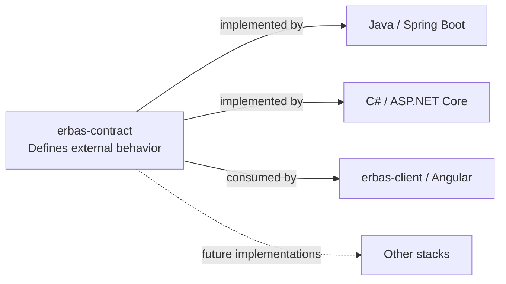

# ERBAS Contract

> One executable contract. Multiple interchangeable implementations.

[](LICENSE)

[](https://github.com/alxarafe/erbas/actions/workflows/ci.yml)
[](https://github.com/alxarafe/alxarafe-dotnet/actions/workflows/ci.yml)
[](https://github.com/alxarafe/erbas-client/actions/workflows/ci.yml)

[](https://github.com/alxarafe/erbas-contract/tree/v0.8.0)
[](openapi/erbas.yaml)
[](bruno/)
[](docs/usage.md)

ERBAS Contract defines one observable HTTP API for independent backend stacks
and a shared client. OpenAPI specifies the behavior; one Bruno collection checks
it against a supplied URL, keeping implementation details outside the contract.
Sources separate common HTTP primitives, CORE platform behavior and functional
modules while retaining one API, version, OpenAPI root and collection. See the
[source ownership decision](docs/decisions/0002-contract-source-boundaries.md).

## ERBAS ecosystem



| Repository | Responsibility | Current status |
| --- | --- | --- |
| [erbas-contract](https://github.com/alxarafe/erbas-contract) | Shared OpenAPI and sole Bruno conformance collection | Published immutable v0.8.0; unpublished v0.9.0 preparation |
| [erbas](https://github.com/alxarafe/erbas) | Java/Spring Boot backend implementing Health, AUTH-001, USERS-001 and COLLECTIONS-001 | Adopted v0.6.0; authoritative `./bin/check` requires shared conformance locally and in CI |
| [alxarafe-dotnet](https://github.com/alxarafe/alxarafe-dotnet) | .NET backend implementing Health, AUTH-001, USERS-001 and COLLECTIONS-001 plus platform modules | Adopted v0.6.0; authoritative `./bin/check` requires shared conformance locally and in CI |
| [erbas-client](https://github.com/alxarafe/erbas-client) | Angular 22 client consuming Health, AUTH-001, USERS-001 basic user administration and COLLECTIONS-001 pagination from either backend | Shared client for both backends; real Java/.NET interoperability verified |

Backends own their builds and isolated test infrastructure; this repository
owns the shared contract. The client works against either backend through its
same-origin Nginx proxy, keeping each opaque token only in memory.

## Quick start

```bash
./bin/check
# Export ERBAS_TEST_EMAIL and ERBAS_TEST_PASSWORD for an isolated administrator.
# Configure disposable conformance composition; see docs/usage.md.
./bin/test URL
```

`./bin/check` validates OpenAPI and verifies the runner using synthetic servers.
`./bin/test URL` validates OpenAPI and checks the already running service at URL.
The added `Contract CI` workflow invokes `./bin/check` on pull requests and
pushes to `main`, without publishing anything.

Conformance mutates users, module states and WMS catalogues and requires an isolated disposable environment.
Both run through Docker; see [usage and networking](docs/usage.md).

See [development ports](docs/common/development-ports.md) for local infrastructure conventions.

This branch prepares **unpublished v0.9.0** capability descriptors and contextual
discovery. See [CORE-CAP-001](docs/core/capabilities-001.md).
No backend or client v0.9.0 adoption or conformance is claimed.

## Current contractual coverage

**v0.8.0 is the current published immutable release**, including CORE module
administration, WMS UoMs, Storage Attributes, Item Families and associations. See [versioning](docs/common/versioning.md)
and [WMS-003](docs/modules/wms/wms-003.md). Backend adoption, shared conformance and client
consumption are separate facts; the recorded Java/.NET adoption remains v0.6.0.

```text
GET /health
200 application/json
{"status":"ok"}
```

This public probe only establishes HTTP process liveness, not PostgreSQL or
dependency health; exact response rules are in [OpenAPI](openapi/erbas.yaml).

AUTH-001 adds `POST /api/auth/login`: email/password JSON, a minimal access-token
response, and distinct 400/401 errors. See [AUTH-001](docs/core/auth-001.md) for the
contract and test credentials; its dated compatibility review records historical
adaptation requirements.

USERS-001 adds `/api/auth/me` and administrator-only user list, get, create and
update operations. Disabled users cannot authenticate or retain access. See
[USERS-001](docs/core/users-001.md) for the minimal model and rules.
[COLLECTIONS-001](docs/common/collections.md) standardizes paged collections and applies
`items`, `offset`, `limit`, `total`, `order` to user listing. Both backends
implement these capabilities; Angular consumes basic user administration and
pagination from either backend. See the
[client development guide](https://github.com/alxarafe/erbas-client/blob/main/docs/full-stack-development.md)
for behavior and verification scope.

Java and .NET both pin published `v0.6.0` and require the shared suite through
their authoritative `./bin/check`, locally and in GitHub Actions.
.NET's `POST /api/auth/register` remains an
[implementation-specific extension](docs/common/implementation-extensions.md).
Angular CI checks the client and isolated runtime proxies; the
[real dual-backend demo](https://github.com/alxarafe/erbas-client/blob/main/docs/full-stack-development.md#web-002-integration-verification-2026-10-09)
provides separate integration evidence. Workflow results do not guarantee future
backend conformance.

## Documentation and next steps

The [shared demo defaults](demo/README.md) define public initial development/demo
credentials now consumed by Java, .NET and the Angular client's full-stack demo
orchestration.

Start with the [documentation index](docs/README.md) for usage, decisions,
verification evidence, versioning, and working rules.

`v0.4.0` is the first published immutable release, adopted by both backends.
CONTRACT-002 is complete. See the [release notes](docs/releases/v0.4.0.md) and
[versioning/publication procedure](docs/common/versioning.md) for its exact commit and
consumption policy. Consumers must pin the published version and verify conformance.
Backend workflows and their coverage are described in the
[documentation index](docs/README.md#verification-badges).

## License

Copyright (c) 2026 Alxarafe. Licensed under [Apache-2.0](LICENSE).
